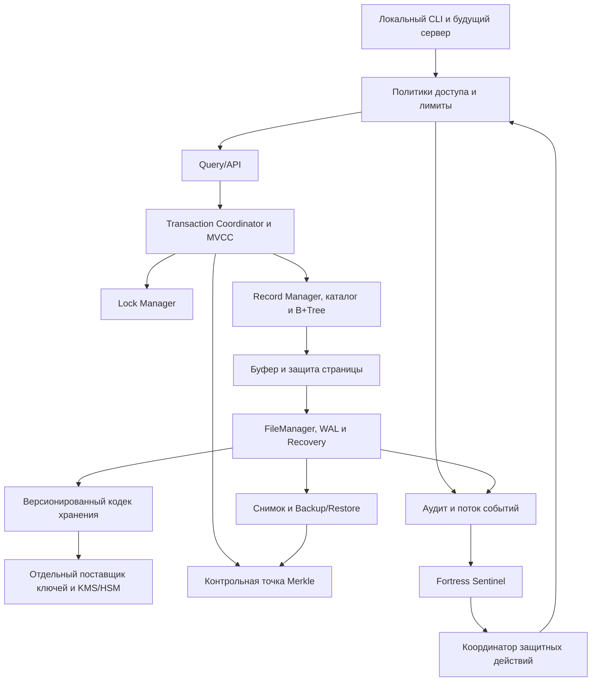

# ZenthrilDB v1.0 и Fortress‑20

ZenthrilDB — самостоятельная СУБД на C++23. Fortress‑20 задаёт границы доверия, правила хранения, контроль доступа и эксплуатационные требования этой же СУБД. Первая цель — локальный v1.0 с проверяемым форматом, транзакциями и восстановлением. Серверный протокол и официальный Go-драйвер открывают следующий путь к замене PostgreSQL в Zenthril. До подтверждения функционального паритета и безопасного перехода PostgreSQL обслуживает рабочую систему, Redis остаётся инфраструктурной зависимостью, существующий E2EE сохраняется.

## Текущая реализация и ограничения

| Модуль | Что выполняет прикладной путь | Что нужно завершить |
|---|---|---|
| FileManager, Page, CRC | Файловый префикс v1, страницы по 8192 байта, CRC32, Page LSN в формате страницы v2, синхронизация средствами ОС. Эксклюзивная межпроцессная блокировка через sidecar. | Дескрипторные операции с проверкой путей, ссылок, прав и типа файла. Recovery физически повреждённых страниц и заголовка. CRC обнаруживает случайное повреждение. |
| WAL и Recovery | WAL-before-data, синхронизация COMMIT и startup REDO/UNDO. Связанные пары сверяют UUID, поколение и LSN. При однозначной истории можно восстановить повреждённую страницу из полного образа. | Криптографическая аутентификация, внешний якорь против отката, безопасный checkpoint, бюджет роста WAL и испытания носителя. [Физическое восстановление](../PHYSICAL_RECOVERY_RU.md) |
| MetadataManager и FreePageManager | Каталог страниц расширяется в одной транзакции с операцией, free-list и заголовком. Старый каталог читается. | Каталог таблиц до 63 таблиц, free-list до 2 039 свободных страниц. Нужны масштабирование и проверка графа владения всеми страницами. |
| Record Manager | Двоичный KV CRUD и таблицы через CLI. Одна страница на запись, атомарное обновление цепочки, общий мьютекс runtime. | Многостраничные значения и ограничение рабочей памяти. B+Tree, стабильный контракт запросов. |
| BufferManager и BufferPageGuard | Отдельная библиотека с учётом pin и RAII. Прикладной путь её пока не использует. | Защита содержимого страницы, владение guard, политика вытеснения, граница WAL-before-data для dirty flush. |
| TransactionManager и LockManager | WAL-жизненный цикл и идентификаторы транзакций. Автокоммит каждой мутации. Отдельный LockManager поддерживает базовые очереди, таймауты и обнаружение циклов. | Публичные многооперационные транзакции, MVCC, совместное восстановление heap/индекса. Интеграция отмены, освобождения блокировок и выбора жертвы вне внутреннего мьютекса. |
| Backup и поставка | Копирование согласованной пары, отдельное восстановление и сравнение SHA‑256 в CLI smoke. CMake, CTest, CPack, Windows и Ubuntu. | Формат снимка с идентичностью и поколением, эксплуатационные испытания, обновления и проверяемое происхождение сборок. |

В CMake нет сторонних библиотек времени выполнения. Используются стандартная библиотека C++ и API Windows/Linux. Интерфейсы из `core/EncryptionInterfaces.hpp` не подключены к пути хранения, не задают nonce/AAD и возвращают ключевой материал. Криптографический контракт предстоит спроектировать с изолированным поставщиком ключей.

## Границы модулей и зависимости

- Страницы. После утверждения формата буфер оперирует проверенным открытым представлением в памяти. Кодек на границе ввода-вывода проверяет аутентичность до разбора payload. Тип, ID, версия формата и контекст страницы входят в AAD. Гарантия WAL-before-data действует и при вытеснении.
- WAL. Привязка идентичности базы и поколения журнала проверяется до изменений. Аутентифицированные LSN и тип записи участвуют в решении REDO/UNDO. Правила nonce и хранения ключей должны переживать обрыв записи, восстановление, откат к снимку и ротацию.
- Merkle и аудит. Merkle-root публикуется для подтверждённого снимка. Независимый якорь выявляет откат к старому снимку. Аудит имеет отдельную хеш-цепочку и внешние контрольные точки. Перезапись локального журнала вместе с локальным якорем остаётся угрозой.
- Ключи. `DatabaseRuntime` получает узкие операции ключевого провайдера. Хранилище обёрнутых ключей, политики ротации и доступ к KMS/HSM образуют отдельную границу. Экспорт открытого ключевого материала исключён из прикладного интерфейса.
- Агенты. Sentinel читает ограниченные события и выдаёт рекомендации координатору политик. Только координатор применяет ограниченные, обратимые действия через интерфейс доступа. Агенты не пишут страницы, WAL, правила доступа или ключи.
- Сеть. Серверный протокол зависит от устойчивого Query/API, транзакций и лимитов. TLS, аутентификация, авторизация и отмена запроса проектируются до включения сетевого слушателя.

## Модель угроз и минимальные требования v1.0

[Модель угроз STRIDE](../security/THREAT_MODEL.md) содержит границы, риски, владельцев и проверку каждого контроля. [Таблица двадцати уровней](FORTRESS_20.md) связывает уровни с компонентами и критериями. Минимальный обязательный профиль локального выпуска записан в [сохранённых критериях v1.0](../RELEASE_ACCEPTANCE_RU.md). Сетевые требования применяются к серверному профилю. Расширенная защита проходит свои этапы приёмки.

[Криптографический проект](../security/CRYPTOGRAPHIC_DESIGN.md), [управление ключами](../security/KEY_MANAGEMENT.md), [агенты Sentinel](../security/SECURITY_AGENTS.md), [проверки](../security/SECURITY_TESTING.md) и [реагирование](../security/INCIDENT_RESPONSE.md) деталируют контракты.

## Совместимость и миграция

Старые пары открываются в режиме совместимости. Новый WAL получает версионированный префикс, продублированный в зарезервированной странице 0 базы. `snapshot` создаёт новое поколение в отдельном каталоге, сохраняя UUID и историю LSN. Для возврата к старому формату нужна исходная пара. [Формат и совместимость](../WAL_IDENTITY_RU.md)

Будущий зашифрованный формат проходит отдельное согласование. После утверждения нужен явный выбор оператора: сохранить исходную пару с манифестом SHA‑256, открыть проверенную копию прежней версией, перенести логические данные в новый каталог, сверить схему, число записей и содержимое, проверить повторное открытие, аварийное восстановление и ротацию. Публикация новой пары происходит только после проверок и синхронизации. Исходная копия сохраняется для отката. Оператор отдельно проверяет ключи восстановления, поколения WAL и запрет автоматического открытия зашифрованных файлов старой версией.

## Очерёдность и критерии

[Дорожная карта Fortress‑20](../roadmap/FORTRESS_ROADMAP.md) объединяет двенадцать этапов и описывает проверки переходов. Ближайшие зависимости ядра: подтверждённая принадлежность WAL → решение о восстановлении физически повреждённых страниц → безопасный checkpoint → масштабирование free-list и развитие Record Manager. Security Foundation идёт параллельно: безопасные файловые операции, ограничения парсеров, минимизация диагностических событий, конфигурация и интерфейсы владения ключами.

Для перехода Zenthril нужен отдельный проверенный план совместимости и отката: инвентаризация SQL/типов/ограничений, Go-драйвер, изолированный IPC по ранее утверждённому допуску, затем испытание только на некритичных журналах, сверка с PostgreSQL и операционный допуск. Пользовательские аккаунты, сообщения и ключи входят только в отдельно утверждённый этап миграции.
