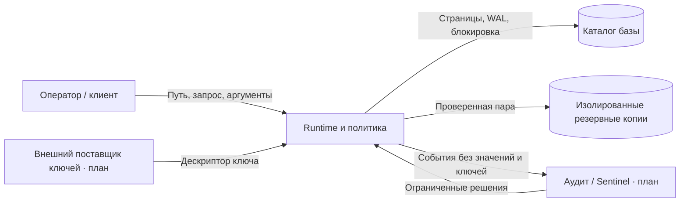

# Модель угроз ZenthrilDB

Применён процесс OWASP Threat Dragon: карта потоков и границ, классификация STRIDE, владелец риска и проверяемая мера. Схема хранится в Markdown, приложения Threat Dragon для построения этой версии не требовалось. Модель описывает локальный v1.0 и выделяет угрозы будущего сервера. [OWASP Threat Dragon](https://owasp.org/projects/threat-dragon), [OWASP Threat Modeling](https://cheatsheetseries.owasp.org/cheatsheets/Threat_Modeling_Cheat_Sheet.html)

## Активы и границы доверия

Активы: подтверждённые записи, заголовки и страницы, WAL и снимки, полномочия оператора, ключи и конфигурация, аудит и доступность восстановления. Доверие ограничено учётной записью процесса, конфигурацией сборки и ОС. Владелец каталога хранения обязан обеспечить изоляцию. Компрометация процесса с доступом к открытому тексту или административного доступа к ОС требует отзыва полномочий, проверки снимков и восстановления.

Границы проходят между клиентом и runtime, runtime и файловой системой, основным каталогом и архивом, процессом и поставщиком ключей, защитной телеметрией и полномочиями на действия. Сетевой клиент, периметр и межсервисная аутентификация добавляются с сервером.

## Реестр рисков

| Риск | STRIDE | Приоритет / владелец | Мера и проверка |
|---|---|---|---|
| Открытие WAL другой базы или устаревшего снимка | S/T | Высокий / Storage | В связанном формате UUID, поколение и граница LSN проверяются до записи. В legacy остаётся проверка образов заголовка. Внешний якорь для отката целой пары и аутентификация содержимого остаются открыты. [WAL Identity](../WAL_IDENTITY_RU.md) |
| Неверный формат, частичная страница, потеря подтверждённой записи | T/D | Высокий / Recovery | Связанная пара восстанавливает повреждённые страницы при однозначном образе. Проверяются CRC, версия, тип, размер и Page LSN. Повреждения заголовка базы, страницы 0 или WAL требуют отдельной процедуры. [Физическое восстановление](../PHYSICAL_RECOVERY_RU.md) |
| Алиас пути, ссылка или небезопасные права позволяют открыть соседние файлы | S/T/I/E | Высокий / Storage и Operations | Операции через проверенные дескрипторы, приватные каталоги, проверка типа и идентичности файла. Тесты границ путей, прав и отказов на обеих ОС. |
| Потребление памяти, диска и времени парсером, WAL или запросом | D | Высокий / Storage и Query | Лимиты на объект и на сессию, бюджет replay, консервативный checkpoint. Негативные тесты длин и нагрузка с измеренным пределом. |
| Утечка открытых страниц, WAL, резервных копий или диагностики | I | Высокий / Crypto и Operations | Минимизация событий, закрытые права, шифрование на границе I/O. Проверка журналов без секретов и восстановление с верным ключом. |
| Потеря, повторное использование или компрометация ключа | I/T/D | Высокий / Key Management | Разделение доменов, версии ключей, проверяемая ротация и резервное восстановление ключей. Тесты неверного ключа, сбоя ротации, nonce после replay. |
| Подмена или отрицание административного действия | S/R/E | Высокий / Security Foundation | Политика deny-by-default, минимальные роли, отдельный аудит, внешняя контрольная точка. Проверка матрицы ролей, отказа и обнаружения пропуска. |
| Поддельное событие либо ложная блокировка от агента | S/T/D/E | Высокий / Sentinel | Аутентификация событий, защита от replay, ограничение TTL и области воздействия, ручное подтверждение критических действий. Проверка отзыва и отказа агента. |
| Компрометация сборки или зависимости | T/E | Высокий / Release | Инвентаризация зависимостей, закреплённые CI-инструменты, контроль происхождения, подпись и проверка релиза. SHA‑256 сам по себе подтверждает совпадение с манифестом. |
| Сетевой перебор, превышение полномочий, повтор команды | S/D/E | Высокий / Server | TLS, квоты, авторизация каждой операции, ограничение сетевых парсеров и отдельные роли управления. Проверяется до включения сервера. |

Обновлять реестр при изменении форматов, ключевого контура, протокола и состава агентов. Для перехода риска в закрытый статус нужен воспроизводимый тест или документированная проверка развёртывания.
